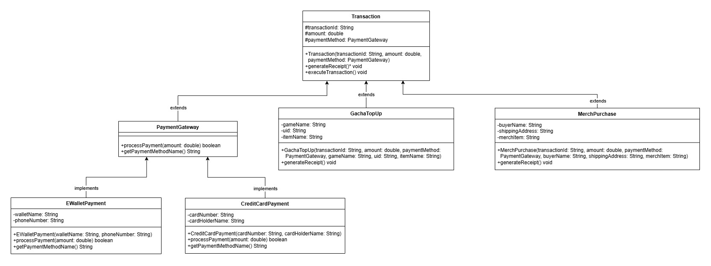

# Studi Kasus: Sistem Transaksi Digital

## 1. Pendahuluan
Proyek ini adalah simulasi sistem transaksi digital yang berfokus pada pembelian *merchandise* dan *top-up* game. Kode ini dibuat untuk mengimplementasikan empat pilar utama Pemrograman Berorientasi Objek (OOP) dalam satu aplikasi Java yang sederhana dan saling terintegrasi.

## 2. Class Diagram

## 3. Penjelasan Konsep Abstract dan Inheritance yang Diterapkan
Berikut adalah penjelasan detail mengenai konsep penting yang diimplementasikan di dalam kode:

A. **Interface (`PaymentGateway.java`)**
File ini bertindak sebagai kontrak untuk semua metode pembayaran. 
- Karena setiap metode pembayaran (seperti E-Wallet dan Kartu Kredit) memiliki alur logika verifikasi yang sangat berbeda, kita menggunakan `interface`. 
- Pendekatan ini memastikan bahwa setiap class yang menggunakannya wajib melakukan *override* pada method `processPayment()` dengan cara mereka masing-masing tanpa merusak struktur utama.

B. **Abstract Class (`Transaction.java`)**
File ini merupakan class induk yang bersifat abstrak.
- Class ini tidak bisa diinstansiasi secara langsung karena sebuah objek "Transaksi" masih terlalu umum dan belum memiliki bentuk produk yang spesifik.
- Class ini menyimpan atribut dasar (seperti ID transaksi dan total bayar) serta satu *abstract method* yaitu `generateReceipt()`. Method ini wajib di-override oleh *child class* untuk mencetak struk yang sesuai dengan jenis transaksinya.

C. **Inheritance (Pewarisan)**
Class `GachaTopUp.java` dan `MerchPurchase.java` adalah *child class* yang mewarisi sifat dari `Transaction.java`.
- Kedua class ini mengambil semua atribut dan fungsi dasar dari *parent class*.
- Selain itu, mereka menambahkan atribut uniknya masing-masing. Misalnya, `GachaTopUp` butuh data UID pemain, sedangkan `MerchPurchase` butuh data alamat pengiriman.

D. **Polymorphism (Banyak Bentuk)**
Polimorfisme memungkinkan kita menggunakan satu tipe referensi untuk menyimpan berbagai bentuk objek yang berbeda. Dalam file `Main.java`, konsep ini diterapkan melalui dua cara:
1. **Melalui Interface:** Variabel dengan tipe `PaymentGateway` bisa digunakan untuk menyimpan objek `EWalletPayment` maupun `CreditCardPayment`.
2. **Melalui Abstract Class:** Variabel dengan tipe `Transaction` dapat memanggil method `executeTransaction()`. Saat *runtime*, Java akan secara otomatis memanggil method `generateReceipt()` yang tepat sesuai dengan tipe objek aslinya (apakah itu struk *Top-up* atau struk *Merchandise*).